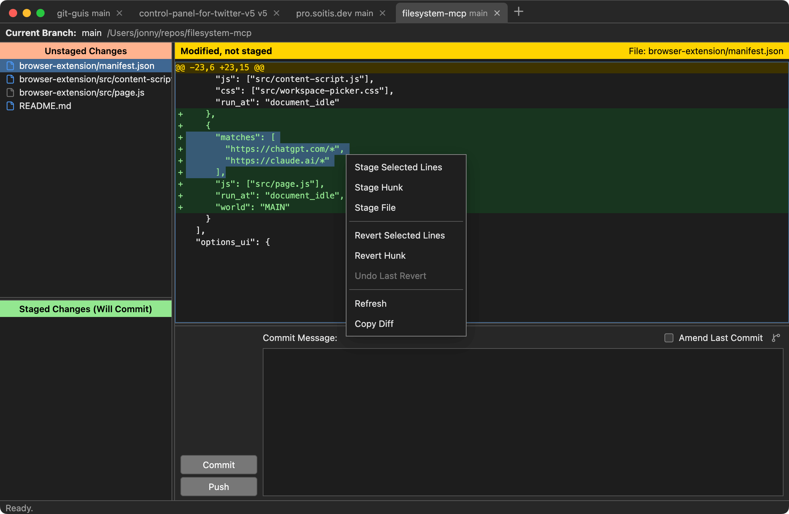

<p align="center">
  
</p>

# Git Guis

Git Guis is a partial clone of `git gui` (just the bits I use) which fixes the following issues I have as a long-time enjoyer of `git gui` as a separate workspace for reviewing changes and building commits:

- `git gui` isn't tabbed, so you need a separate window per repo
- The `wish` runtime misbehaves in the macOS Dock, leaving ghost entries
- There's no keyboard shortcut for staging/unstaging selected lines

It also adds a new branch pane which contains just the bits of `gitk` I use (checkout, cherry-pick and reset).



## Development

Requires Node.js 22.12+ (or 24+), npm, and Git. On Windows, install Git for
Windows with Git available on PATH, then use PowerShell or Command Prompt.

```sh
npm install
npm run dev
```

`npm run dev` starts Vite on `http://127.0.0.1:5173/` and launches Electron.

Run Biome and TypeScript checks:

```sh
npm run check
```

Apply Biome formatting and safe fixes:

```sh
npm run check:fix
```

## Builds

```sh
npm run build     # build renderer and Electron code
npm run package   # create an unpacked application
npm run make      # create configured distributables
npm run make:win  # create a Windows x64 installer (run on Windows)
npm run make:mac  # create an Apple Silicon macOS zip
```

Build output is written to `dist/`, `dist-electron/`, and `out/`.

On Windows, `npm run package` creates `out/Git Guis-win32-x64/Git Guis.exe`
(the architecture follows the current machine). `npm run make:win` creates the
installer in `out/make/squirrel.windows/x64/`. Git must also be on PATH when
running the packaged app; Node.js is only needed for development and the `ggs`
terminal helper.

To use `ggs` from PowerShell or Command Prompt, run `npm link` from this checkout
after packaging. Then run `ggs` inside a repository, or `ggs "C:\path to\repo"`.
The helper finds the installed app or this checkout's packaged app. Set
`GIT_GUIS_APP` to the full path to `Git Guis.exe` to use another copy.
The in-app **Install Terminal Helper** menu is macOS-only.

Source files use LF line endings, enforced by `.gitattributes`, so Windows
checkouts pass the same formatting checks as macOS.
